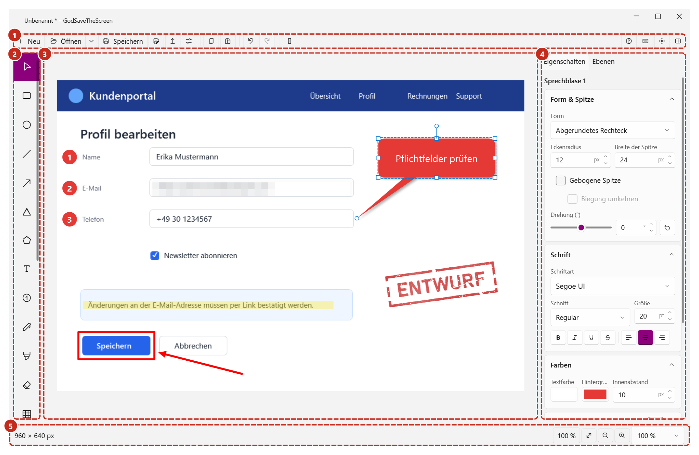
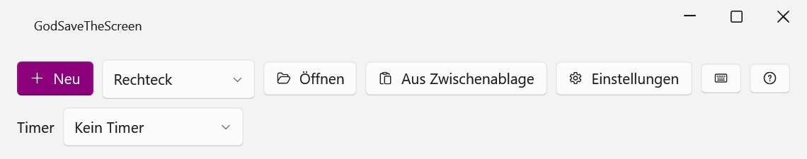
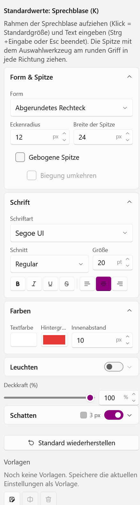
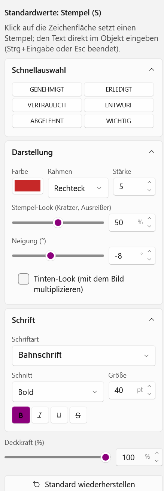
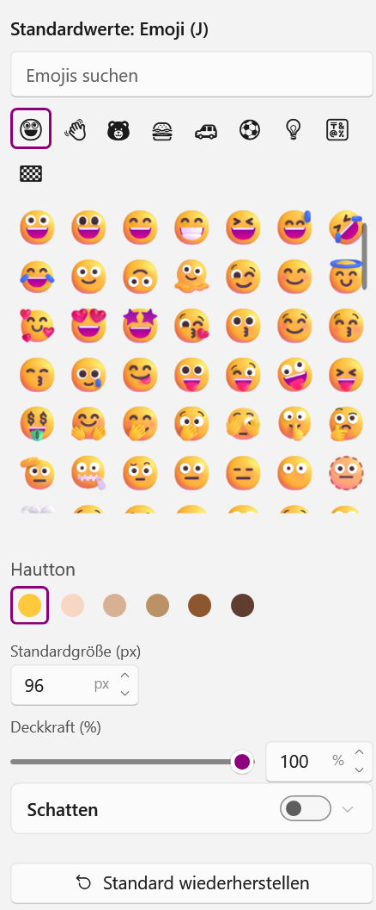
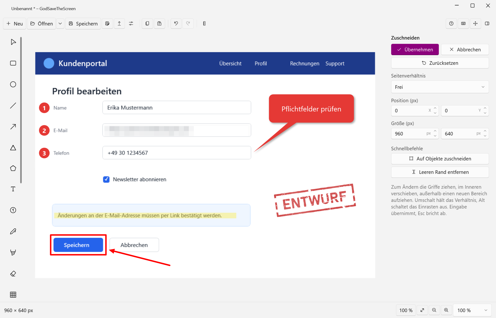
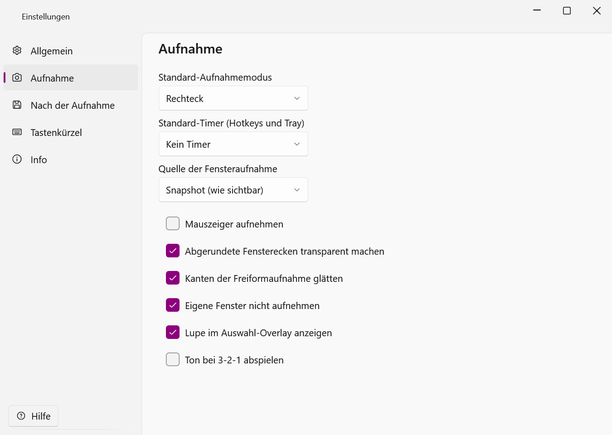

# GodSaveTheScreen

[English](README.md) · **Deutsch**

Screenshot- und Annotationstool für Windows (.NET 10, WPF). Es läuft im Infobereich der Taskleiste, nimmt Bildschirmbereiche per Hotkey auf und öffnet das Ergebnis in einem Editor. Formen, Text, Pfeile, Sprechblasen, Stempel, Unschärfe und mehr liegen als Objekte über dem Bild und bleiben jederzeit bearbeitbar – auch nach dem erneuten Öffnen eines gespeicherten Projekts.



## Download

Die aktuelle Version gibt es unter [Releases](../../releases), jeweils für `win-x64` und `win-arm64`:

| Datei | Zweck |
|---|---|
| `GodSaveTheScreen-<Version>-<Plattform>-Setup.exe` | Setup mit Wahl „Nur für mich“ (ohne Adminrechte) oder „Für alle Benutzer“, Zielordner und Startmenü-Verknüpfung |
| `GodSaveTheScreen-<Version>-<Plattform>.msi` | Für Softwareverteilung (GPO, Intune, SCCM); Deutsch/Englisch automatisch |
| `GodSaveTheScreen-<Version>-<Plattform>.zip` | Portabel, ohne Installation |

Voraussetzung: Windows 10 (Version 2004) oder neuer. Die .NET-Laufzeit ist enthalten.

## Funktionen

### Aufnahme



- Rechteck, Fenster (mit Fenstererkennung), Freiform (Lasso), Vollbild (aktueller Monitor oder alle Monitore)
- Frei einstellbarer Timer, mehrere Monitore mit unterschiedlicher Skalierung
- Globale Hotkeys, Tray-Symbol, Startfenster, Windows-Sprungliste
- Nach der Aufnahme optional: in die Zwischenablage kopieren, automatisch speichern, Editor öffnen

### Editor

- **Formen:** Rechteck, Ellipse, Linie, Pfeil, Dreieck, Polygon – mit Kontur, Strichelung, Pfeilspitzen, Schatten und Drehung
- **Text und Sprechblasen:** Text mit (auch weicher) Kontur, Hintergrund und Schatten; Sprech-, Oval- und Gedankenblasen mit frei ziehbarer, auf Wunsch gebogener Spitze, drehbar
- **Stempel:** „GENEHMIGT“, „ENTWURF“ oder eigene Texte, mit realistisch abgenutztem Stempel-Look, Neigung und Tinten-Effekt
- **Nummerierte Marker**, Stift, Textmarker, Radierer, virtuelles Lineal
- **Unschärfe** (Weichzeichnen, Verpixeln, Schwärzen) und **Lupe**
- **Farbige Emojis** (alle Windows-Emojis außer Länderflaggen) mit Suche auf Deutsch und Englisch, Kategorien, Favoriten und Hauttönen
- **Bilder als Objekte:** alle WIC-Formate und SVG per Werkzeug, Drag & Drop oder `Strg+Umschalt+V` einfügen, drehbar, spiegelbar, mit Kontur und Schatten
- **Bildbereiche entfernen:** Bereiche per Rechteck, Ellipse, Lasso oder Zauberstab bzw. mit dem Hintergrundradierer transparent machen – nicht-destruktiv und jederzeit wiederherstellbar
- **Die Zeichenfläche wächst mit**, wenn Objekte über den Bildrand hinausragen; der zusätzliche Bereich wird transparent exportiert
- Alle Objekte bleiben bearbeitbar: Auswahl, Griffe, Ebenenliste, Z-Reihenfolge, Sperren, Undo/Redo
- Vorlagen für jedes Zeichenwerkzeug; jedes Werkzeug merkt sich seine letzten Einstellungen, „Standard wiederherstellen“ setzt sie zurück

<table>
  <tr>
    <td></td>
    <td></td>
    <td></td>
  </tr>
  <tr>
    <td align="center">Sprechblase</td>
    <td align="center">Stempel</td>
    <td align="center">Emoji</td>
  </tr>
</table>

### Zuschneiden und Export



- Zuschneiden wie im Snipping Tool: nicht-destruktiv und später wieder erweiterbar, mit Seitenverhältnissen, Pixel-Eingabe, Einrasten, „Auf Objekte zuschneiden“ und „Leeren Rand entfernen“
- Zoom und Verschieben, Bild per Drag & Drop ein- und ausgeben
- Speichern als PNG, JPEG, BMP, GIF, TIFF und JPEG XR; Laden aller von Windows (WIC) unterstützten Formate

### Projekte (`.gsts`)

- Originalbild, Zuschnitt, Maske und alle Objekte in einer ZIP-Datei – Bearbeitung nach dem Schließen fortsetzen
- Zuletzt verwendete Dateien in Startfenster, Tray, Editor und Sprungliste
- Automatische Sicherung ungespeicherter Arbeit und Wiederherstellung nach einem Absturz

### Bedienung



- Deutsch und Englisch, Hell/Dunkel/Hochkontrast
- Alle Funktionen per Tastatur erreichbar; `Strg+F1` zeigt alle Tastenkürzel
- Ausführliche Benutzeranleitung auf Deutsch und Englisch (HTML neben der EXE): `F1` öffnet sie, `Umschalt+F1` springt zum Abschnitt des aktuellen Werkzeugs bzw. der Einstellungsseite

## Tastenkürzel (Auszug)

| Taste | Funktion |
|---|---|
| `Strg+Umschalt+1` … `4` | Aufnahme: Rechteck / Fenster / Freiform / Vollbild (Standard, änderbar) |
| `V` `R` `E` `L` `A` `G` `P` | Auswahl, Rechteck, Ellipse, Linie, Pfeil, Dreieck, Polygon |
| `T` `K` `S` `M` `J` `I` | Text, Sprechblase, Stempel, Marker, Emoji, Bild |
| `B` `H` `X` `U` `Z` `C` | Stift, Textmarker, Radierer, Unschärfe, Lupe, Zuschneiden |
| `W` / `D` | Bereich auswählen und entfernen / Hintergrundradierer |
| `Strg+Z` / `Strg+Y` | Rückgängig / Wiederholen |
| `Strg+C` / `Strg+Umschalt+C` | Auswahl bzw. Bild kopieren / Bild immer kopieren |
| `Strg+V` / `Strg+Umschalt+V` | Einfügen / Bild als Objekt einfügen |
| `Strg+S` / `Strg+Umschalt+S` | Speichern / Speichern unter (Projekt oder Bild) |
| `[` / `]` | Ausgewähltes Objekt drehen |
| Pfeiltasten (+`Umschalt`) | Auswahl um 1 px (10 px) verschieben, mit `Alt` Größe ändern |
| `F1` / `Umschalt+F1` | Hilfe / Hilfe zum aktuellen Werkzeug |
| `Strg+F1` | Alle Tastenkürzel |

## Installation im Detail

Stille Installation:

```powershell
msiexec /i GodSaveTheScreen-1.10.1.0-win-x64.msi /qn ALLUSERS=1   # für alle Benutzer (Admin)
msiexec /i GodSaveTheScreen-1.10.1.0-win-x64.msi /qn              # nur aktueller Benutzer
GodSaveTheScreen-1.10.1.0-win-x64-Setup.exe /quiet InstallScope=PerMachine
```

- MSI-Properties: `ALLUSERS=1` (für alle Benutzer), `MSIINSTALLPERUSER=1` (nur Benutzer, Standard), `INSTALLFOLDER`, `STARTMENUSHORTCUT=0`
- Setup-EXE: `InstallScope=PerMachine|PerUser`, `InstallFolder=<Ordner>`, `StartMenuShortcut=0`. Burns eigene Schalter `/permachine`/`/peruser` wirken nicht.
- Updates ersetzen eine Installation derselben Art und übernehmen Ordner und Startmenü-Wahl; ein Wechsel zwischen „Benutzer“ und „alle Benutzer“ ergibt zwei Installationen.
- „Mit Windows starten“ stellt jeder Benutzer in der App ein, nicht das Setup.

**Portabel (ZIP):** entpacken und `GodSaveTheScreen.exe` starten; die HTML-Dateien der Benutzeranleitung im selben Ordner lassen. Einstellungen liegen in `%APPDATA%\GodSaveTheScreen`, Logs und Sicherungen in `%LOCALAPPDATA%\GodSaveTheScreen`. Mit einer leeren Datei `portable.txt` neben der EXE liegen alle Daten im Ordner `data` daneben (z. B. für USB-Sticks).

**SmartScreen:** EXE und Installer sind noch nicht signiert. Beim ersten Start zeigt Windows deshalb unter Umständen „Der Computer wurde durch Windows geschützt“: *Weitere Informationen → Trotzdem ausführen*.

**Taste `Druck`:** Unter Windows 11 kann sie vom System belegt sein (*Einstellungen → Barrierefreiheit → Tastatur → „Schaltfläche ‚Druck‘ zum Öffnen der Bildschirmaufnahme verwenden“*). Erst nach dem Ausschalten lässt sie sich in GodSaveTheScreen einem Aufnahmemodus zuweisen.

## Aus dem Quelltext bauen

Voraussetzung: [.NET 10 SDK](https://dotnet.microsoft.com/download), Windows 10 (2004) oder neuer.

```powershell
dotnet build GodSaveTheScreen.slnx                     # Bauen (Warnungen sind Fehler)
dotnet run --project src/GodSaveTheScreen.App
.\build\release.ps1                                    # Tests + je Plattform Publish, ZIP, MSI, Setup-EXE in dist\
.\build\release.ps1 -Runtime win-x64 -SkipInstaller    # nur x64, nur ZIP
```

Tests (xUnit v3): `dotnet test` führt in dieser Solution derzeit keine Tests aus. Stattdessen die Testprogramme aus der Build-Ausgabe starten:

```powershell
dotnet build -p:ArtifactsPath=C:/Temp/gsts-art
C:/Temp/gsts-art/bin/GodSaveTheScreen.Core.Tests/debug/GodSaveTheScreen.Core.Tests.exe
C:/Temp/gsts-art/bin/GodSaveTheScreen.App.Tests/debug/GodSaveTheScreen.App.Tests.exe
```

Hinweise:
- Läuft die App, sperrt sie die DLLs in `bin\`; für parallele Builds `-p:ArtifactsPath=…` verwenden.
- Die Versionsnummer steht in `Directory.Build.props` (vierstellig, `Major.Minor.Patch.Fix`); der Git-Hash wird an die `InformationalVersion` gehängt.
- Die Installer entstehen mit WiX Toolset 7 (`installer/`) über `build\build-installer.ps1`. WiX 7 verlangt die Annahme seiner OSMF-EULA (`<AcceptEula>wix7</AcceptEula>` in den Projekten).
- `build\generate-notices.ps1` erzeugt `THIRD-PARTY-NOTICES.txt` nach Paketänderungen neu; `pwsh build/generate-help-screenshots.ps1` erzeugt die Bildschirmfotos der Benutzeranleitung.

## Dokumentation

- Benutzeranleitung: Quellen in [docs/help](docs/help/) (der Build bündelt sie zu je einer HTML-Datei pro Sprache)
- Lizenzseite: Quellen in [docs/license](docs/license/) (`GodSaveTheScreen-Lizenz.html`/`-License.html` neben der EXE, aufrufbar unter Einstellungen → Info)
- [Architektur für KI-Agenten](docs/agent/architecture.md) – das Projekt entsteht mit Unterstützung von Claude Code, siehe auch [CLAUDE.md](CLAUDE.md)
- [Änderungen](CHANGELOG.md)
- [Umsetzungsplan](docs/Umsetzungsplan.md) und [Meilensteine](docs/meilensteine/)

## Lizenz

GodSaveTheScreen ist freie Software unter der [Apache License 2.0](LICENSE) – Copyright © 2026 Patrick Semmler. Nutzung, Weitergabe, Änderungen und Forks sind erlaubt; bitte dabei `LICENSE` und [NOTICE](NOTICE) mitgeben, geänderte Dateien kennzeichnen und für Forks einen eigenen Namen verwenden. Die Lizenzen der verwendeten Komponenten stehen in [THIRD-PARTY-NOTICES.txt](THIRD-PARTY-NOTICES.txt).
