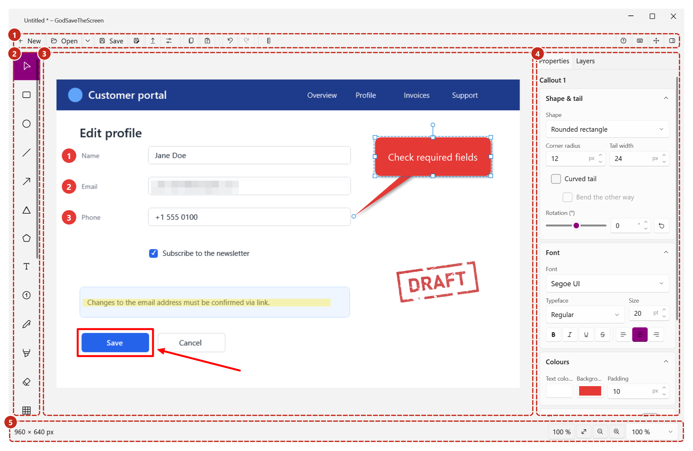
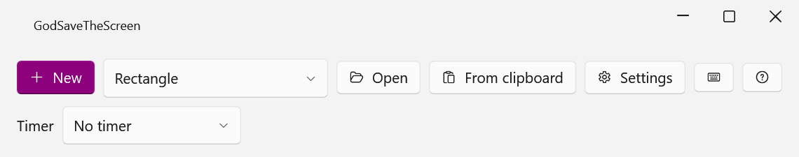
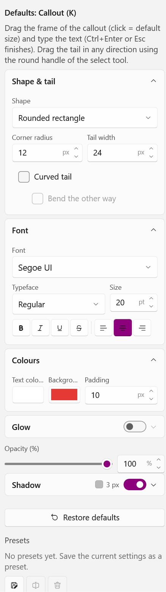
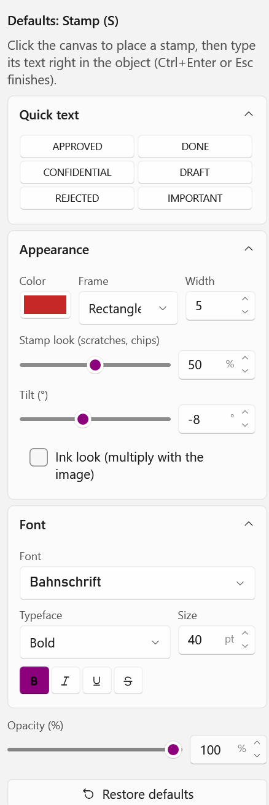
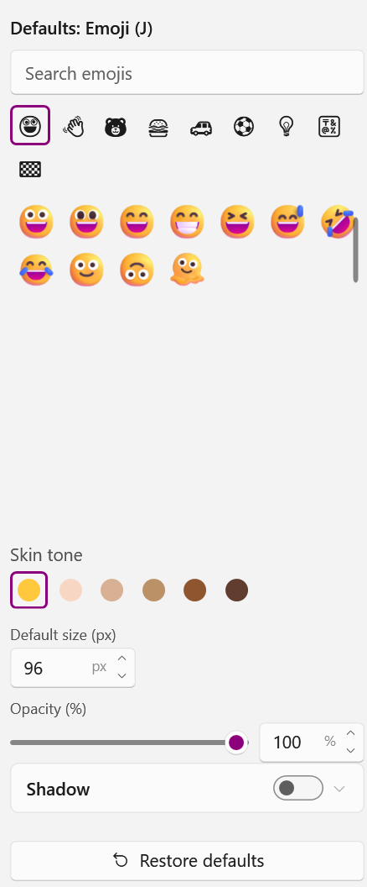
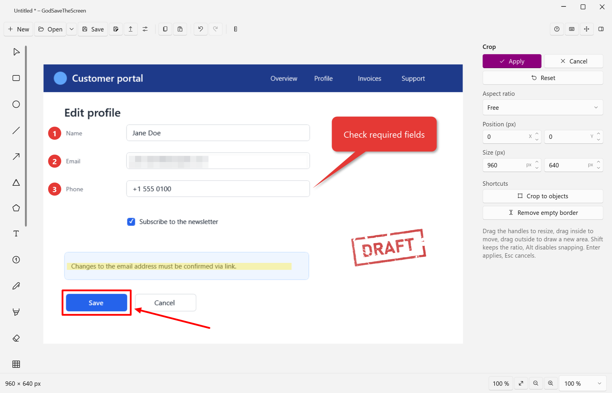
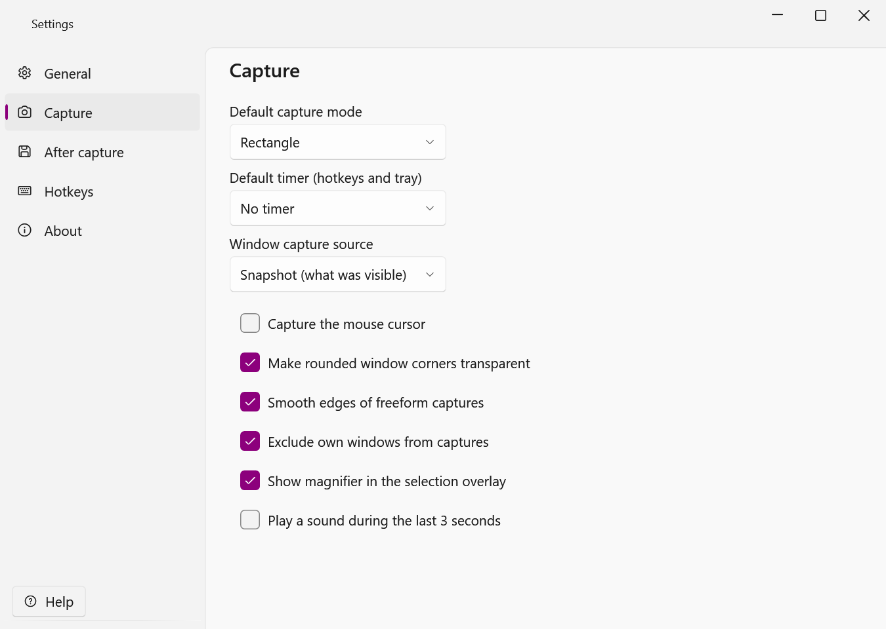

# GodSaveTheScreen

**English** · [Deutsch](README.de.md)

A screenshot and annotation tool for Windows (.NET 10, WPF). It lives in the notification area, captures parts of the screen with a hotkey and opens the result in an editor. Shapes, text, arrows, callouts, stamps, blur and more are placed over the image as objects, so everything stays editable – even after reopening a saved project.



## Download

Get the latest version from the [Releases](../../releases) page. Each release is available for `win-x64` and `win-arm64`:

| File | Use |
|---|---|
| `GodSaveTheScreen-<version>-<platform>-Setup.exe` | Setup with a choice between “Just for me” (no admin rights) and “All users”, install folder and Start menu shortcut |
| `GodSaveTheScreen-<version>-<platform>.msi` | For software deployment (GPO, Intune, SCCM); German/English selected automatically |
| `GodSaveTheScreen-<version>-<platform>.zip` | Portable, no installation required |

Requirements: Windows 10 (version 2004) or later. The .NET runtime is included.

## Features

### Capture



- Rectangle, window (with window detection), freeform (lasso), full screen (current monitor or all monitors)
- Adjustable timer; multiple monitors with different scaling
- Global hotkeys, tray icon, start window, Windows jump list
- After capturing, optionally: copy to clipboard, save automatically, open the editor

### Editor

- **Shapes:** rectangle, ellipse, line, arrow, triangle, polygon – with outline, dashes, arrow heads, shadow and rotation
- **Text and callouts:** text with outline (also soft), background and shadow; speech, oval and thought bubbles with a freely draggable tail, which can be curved and rotated
- **Stamps:** “APPROVED”, “DRAFT” and your own texts, with a realistic worn stamp look, tilt and ink effect
- **Numbered markers**, pen, highlighter, eraser, virtual ruler
- **Blur** (blur, pixelate, black out) and **magnifier**
- **Colour emojis** (all Windows emojis except flags) with search in English and German, categories, favourites and skin tones
- **Images as objects:** insert any WIC format or SVG via tool, drag & drop or `Ctrl+Shift+V`, with rotation, mirroring, outline and shadow
- **Remove parts of the image:** make areas transparent using rectangle, ellipse, lasso or magic wand selection, or with the background eraser – non-destructive and restorable at any time
- **The canvas grows** when objects extend beyond the edge of the image; the extra area is exported as transparent
- All objects stay editable: selection, handles, layer list, z-order, locking, undo/redo
- Presets for every drawing tool; each tool remembers its last settings, with “Restore defaults” available

<table>
  <tr>
    <td></td>
    <td></td>
    <td></td>
  </tr>
  <tr>
    <td align="center">Callout</td>
    <td align="center">Stamp</td>
    <td align="center">Emoji</td>
  </tr>
</table>

### Cropping and export



- Cropping like in the Snipping Tool: non-destructive and expandable again later, with aspect ratios, pixel input, snapping, “Crop to objects” and “Remove empty border”
- Zoom and pan; drag images into and out of the editor
- Save as PNG, JPEG, BMP, GIF, TIFF and JPEG XR; open every format supported by Windows (WIC)

### Projects (`.gsts`)

- Original image, crop, mask and all objects in a single ZIP file – continue editing after closing
- Recently used files in the start window, tray, editor and jump list
- Automatic backup of unsaved work and recovery after a crash

### Usability



- English and German, light/dark/high contrast
- Every function can be reached by keyboard; `Ctrl+F1` shows all shortcuts
- Detailed user guide in English and German (HTML next to the EXE): `F1` opens it, `Shift+F1` jumps to the section for the current tool or settings page

## Keyboard shortcuts (selection)

| Key | Function |
|---|---|
| `Ctrl+Shift+1` … `4` | Capture: rectangle / window / freeform / full screen (default, configurable) |
| `V` `R` `E` `L` `A` `G` `P` | Select, rectangle, ellipse, line, arrow, triangle, polygon |
| `T` `K` `S` `M` `J` `I` | Text, callout, stamp, marker, emoji, image |
| `B` `H` `X` `U` `Z` `C` | Pen, highlighter, eraser, blur, magnifier, crop |
| `W` / `D` | Select area and remove / background eraser |
| `Ctrl+Z` / `Ctrl+Y` | Undo / redo |
| `Ctrl+C` / `Ctrl+Shift+C` | Copy selection or image / always copy image |
| `Ctrl+V` / `Ctrl+Shift+V` | Paste / insert image as object |
| `Ctrl+S` / `Ctrl+Shift+S` | Save / save as (project or image) |
| `[` / `]` | Rotate the selected object |
| Arrow keys (+`Shift`) | Move the selection by 1 px (10 px); with `Alt`, resize |
| `F1` / `Shift+F1` | Help / help for the current tool |
| `Ctrl+F1` | All keyboard shortcuts |

## Installation details

Silent installation:

```powershell
msiexec /i GodSaveTheScreen-1.10.1.0-win-x64.msi /qn ALLUSERS=1   # all users (admin)
msiexec /i GodSaveTheScreen-1.10.1.0-win-x64.msi /qn              # current user only
GodSaveTheScreen-1.10.1.0-win-x64-Setup.exe /quiet InstallScope=PerMachine
```

- MSI properties: `ALLUSERS=1` (all users), `MSIINSTALLPERUSER=1` (current user, default), `INSTALLFOLDER`, `STARTMENUSHORTCUT=0`
- Setup EXE: `InstallScope=PerMachine|PerUser`, `InstallFolder=<folder>`, `StartMenuShortcut=0`. Burn's own `/permachine` and `/peruser` switches have no effect.
- Updates replace an installation of the same kind and keep its folder and Start menu choice. Switching between “current user” and “all users” results in two installations.
- “Start with Windows” is set by each user in the app, not by the setup.

**Portable (ZIP):** unzip and run `GodSaveTheScreen.exe`; keep the user guide HTML files in the same folder. Settings are stored in `%APPDATA%\GodSaveTheScreen`, and logs and backups in `%LOCALAPPDATA%\GodSaveTheScreen`. If you put an empty `portable.txt` next to the EXE, all data is stored in a `data` folder beside it (e.g. for USB sticks).

**SmartScreen:** the EXE and installers are not signed yet, so Windows may show “Windows protected your PC” on first start. Choose *More info → Run anyway*.

**Print Screen key:** on Windows 11 the key may be taken by the system (*Settings → Accessibility → Keyboard → “Use the Print screen key to open screen capture”*). Turn that option off before assigning the key in GodSaveTheScreen.

## Building from source

Requirements: [.NET 10 SDK](https://dotnet.microsoft.com/download), Windows 10 (2004) or later.

```powershell
dotnet build GodSaveTheScreen.slnx                     # build (warnings are errors)
dotnet run --project src/GodSaveTheScreen.App
.\build\release.ps1                                    # tests + publish, ZIP, MSI and Setup EXE per platform into dist\
.\build\release.ps1 -Runtime win-x64 -SkipInstaller    # x64 ZIP only
```

Tests (xUnit v3): `dotnet test` currently runs no tests in this solution. Run the test executables from the build output instead:

```powershell
dotnet build -p:ArtifactsPath=C:/Temp/gsts-art
C:/Temp/gsts-art/bin/GodSaveTheScreen.Core.Tests/debug/GodSaveTheScreen.Core.Tests.exe
C:/Temp/gsts-art/bin/GodSaveTheScreen.App.Tests/debug/GodSaveTheScreen.App.Tests.exe
```

Notes:
- While the app is running it locks the DLLs in `bin\`. For parallel builds, use `-p:ArtifactsPath=…`.
- The version is set in `Directory.Build.props` (four parts, `Major.Minor.Patch.Fix`); the Git hash is appended to the `InformationalVersion`.
- The installers are built with WiX Toolset 7 (`installer/`) by `build\build-installer.ps1`. WiX 7 requires accepting its OSMF EULA (`<AcceptEula>wix7</AcceptEula>` in the projects).
- `build\generate-notices.ps1` regenerates `THIRD-PARTY-NOTICES.txt` after package changes; `pwsh build/generate-help-screenshots.ps1` regenerates the user guide screenshots.

## Documentation

- User guide: sources in [docs/help](docs/help/) (bundled into a single HTML file per language at build time)
- [Architecture notes for AI agents](docs/agent/architecture.md) – the project is developed with the help of Claude Code; see also [CLAUDE.md](CLAUDE.md)
- [Changelog](CHANGELOG.md)
- Internal planning documents (German): [implementation plan](docs/Umsetzungsplan.md), [milestones](docs/meilensteine/)

## License

GodSaveTheScreen is free software under the [Apache License 2.0](LICENSE) – Copyright © 2026 Patrick Semmler. You may use, redistribute, modify and fork it. Please include `LICENSE` and [NOTICE](NOTICE), mark modified files, and use a different name for forks. The licenses of the components used are listed in [THIRD-PARTY-NOTICES.txt](THIRD-PARTY-NOTICES.txt).
